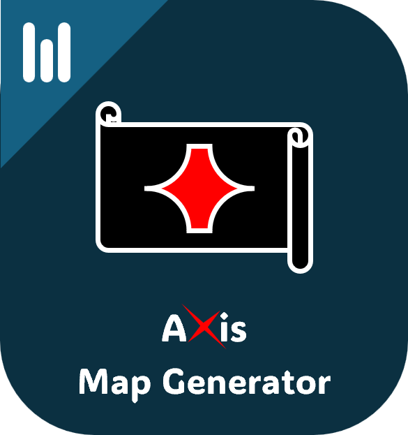

<div align="center">


# Axis Map Generator

**Next-Gen Native Procedural Fantasy Cartography Workstation**

[](https://github.com/MooPuu/Axis-Map-Generator/releases/tag/v2.0.0)
[](https://moopuu.github.io/Axis-Map-Generator/)
[](https://www.rust-lang.org)
[](https://tauri.app)
[](LICENSE)
[](https://github.com/MooPuu/Axis-Map-Generator/releases/tag/v2.0.0)

<p align="center">
  <a href="https://moopuu.github.io/Axis-Map-Generator/" target="_blank"><strong>🌐 Visit Official Website & Showcase</strong></a>
</p>

<p align="center">
  
</p>

*A blazingly fast, lightweight, and modern procedural cartography workstation designed for worldbuilders, game developers, fantasy authors, and tabletop RPG creators. Generate high-resolution continental landmasses, multi-realm territories, isometric Tolkien mountain ridges, and export 16-bit 3D heightmaps.*

</div>

---

## 🌟 Overview

**Axis Map Generator** is part of the **Axis Tools** open-source creative ecosystem. Engineered with a native **Rust + Tauri v2** desktop architecture and a pure client-side **HTML5 Canvas** engine, it replaces clunky, slow map generators with an instant, modern workstation that starts immediately and uses less than **9 MB** of disk space.

Generate infinite fantasy worlds across 7 continental archetypes, customize 13 distinct cartographic themes, manually sculpt terrain in real time, and export production-ready maps for print, web, or 3D game engines (Blender, Unreal Engine 5, Unity).

---

## ✨ Features

### 🌍 Multi-Octave Fractal World Generation
- **7 Continental Archetypes:** Continents & Oceans, Continents, Island Atolls, Archipelago & Isles, Pangaea Supercontinent, Shattered Realms, and Caldera Ring Atolls.
- **Parametric Controls:** Configurable Sea Level, Continentalness, Coastline Roughness, Mountain Density, River Frequency, and Forest Density.
- **Whittaker Biome Simulation:** Realistic biomes based on altitude lapse rate, moisture, and temperature (Desert, Grassland, Forest, Hills, Plains, Savanna, Wetlands, Alpine Peaks, and Tundra).

### 🏔️ Miniature Tolkien Mountain Cordilleras
- **Isometric Mountain Ridges:** Procedural peaks clustered naturally along high-altitude ridgelines.
- **Hand-Engraved Shadow Hatching:** Sunlit northwest slopes with cross-hatched southeast shadows and alpine snowcaps.
- **Foothill Hummocks:** Delicate rolling mounds surrounding mountain skirts, leaving fertile plains and valleys open and visible.

### 💧 Dynamic Hydrology Simulation
- **Hydraulic Flow Accumulation:** River networks that naturally meander downhill, merge into major waterways, and form coastal estuaries.
- **Inland Lakes & Water Basins:** Vector-outlined bodies of water with inner wave ripples.
- **Concentric Coastline Ripples:** Antique nautical isoline ripples echoing shallow water depths.

### 👑 Multi-Realm Dynasties & Political Entities
- **Heraldic Capitals & Citadels:** Fortresses with stone towers, battlements, and flying realm pennant flags.
- **Interactive Labels:** Click any capital, settlement, or ocean name directly on the canvas to rename, or drag to reposition.
- **Trade Routes:** Dashed inter-settlement infrastructure connecting kingdoms across mountain passes and river valleys.

### 🖌️ Live Manual Terrain Sculpting
- **Interactive Brushes:** Live *Raise*, *Lower*, and *Smooth (Erosion)* terrain sculpting tools.
- **Granular Adjustments:** Customize brush radius (10px–100px) and pressure intensity for fine coastal or mountain sculpting.

### 🎨 13 Cartographic Visual Themes
1. **Classic Fantasy:** Antique Tolkien-inspired sepia parchment with engraved hatching.
2. **Watercolor Wash:** Soft blended pigment washes with painterly tones.
3. **Atlas Relief:** Topographic hypsometric elevation tints and shaded relief.
4. **Dark Cartography:** Midnight indigo slate with luminous cyan vectors.
5. **Minimal Ink:** Crisp monochrome architectural line art.
6. **Cyberpunk Neon:** High-contrast neon vectors and electric magenta borders.
7. **Verdant Realm:** Lush emerald kingdoms, sapphire bays, and deep forests.
8. **Tactical Blueprint:** Architectural cyanotype grid with precise white linework.
9. **Pirate Parchment:** Weathered treasure map with antique compass rose.
10. **Pixel RPG:** Retro 16-bit game aesthetics with crisp grid rendering.
11. **Steampunk:** Copper, brass, and sepia engineering cartography.
12. **Hologram:** Sci-fi glowing tactical projection map.
13. **Satellite Natural:** Realistic bathymetric ocean depths and aerial biome tints.

### 📦 Multi-Format Export Pipeline
- **Ultra High-Res PNG:** High-definition exports up to 4K and 8K.
- **Vector SVG:** Scalable vector format for graphic design, print, and publication.
- **16-bit Grayscale Heightmap:** High-dynamic range PNG heightmap ready for direct displacement in Blender, Unreal Engine 5, and Unity.
- **Project Files (`.axis`):** Save and load entire procedural seed states with one click.

---

## 🚀 Downloads & Packages (Windows)

All pre-compiled release packages for Windows 10 & 11 (64-bit) are available on the [v2.0.0 Release Page](https://github.com/MooPuu/Axis-Map-Generator/releases/tag/v2.0.0):

| Package | Description | Download | Size |
|---|---|---|---|
| **Standalone Portable EXE** | Zero installation required. Single self-contained executable. | [**AxisMapGenerator-v2.0.0-windows-x64.exe**](https://github.com/MooPuu/Axis-Map-Generator/releases/download/v2.0.0/AxisMapGenerator-v2.0.0-windows-x64.exe) | ~8.8 MB |
| **Portable ZIP Package** | Compressed archive with executable and documentation. | [**AxisMapGenerator-v2.0.0-windows-portable.zip**](https://github.com/MooPuu/Axis-Map-Generator/releases/download/v2.0.0/AxisMapGenerator-v2.0.0-windows-portable.zip) | ~2.8 MB |
| **Standard Setup (NSIS)** | Standard Windows setup wizard with Start Menu shortcuts. | [**AxisMapGenerator-v2.0.0-setup.exe**](https://github.com/MooPuu/Axis-Map-Generator/releases/download/v2.0.0/AxisMapGenerator-v2.0.0-setup.exe) | ~2.1 MB |
| **Enterprise Installer (MSI)** | WiX MSI installer for corporate and Group Policy rollout. | [**AxisMapGenerator-v2.0.0-x64.msi**](https://github.com/MooPuu/Axis-Map-Generator/releases/download/v2.0.0/AxisMapGenerator-v2.0.0-x64.msi) | ~3.1 MB |

---

## 🔒 Checksums (SHA256)

```text
aa5318ede3ab31f4d4f09b25cd7de62b4f7f238ec87fae878fddd24f35af381e  AxisMapGenerator-v2.0.0-windows-x64.exe
d6406b56a389e35bbb272391b4bc2888604f6b824ce0c54231ec05c4c63a527a  AxisMapGenerator-v2.0.0-windows-portable.zip
bf7ba77a11a708d06660aab3b852aefb01e61caccee4cf73e3ab76cd3a252fe6  AxisMapGenerator-v2.0.0-setup.exe
6d611be62ee48b51efde6c8f4738d2efd0f97b5f2c343c3bfb3972155e3a67f0  AxisMapGenerator-v2.0.0-x64.msi
```

---

## 🛠️ Architecture & Tech Stack

```text
Axis Map Generator
├── Backend (Rust)
│   ├── Tauri v2 (lib.rs, main.rs)
│   ├── Native OS File & Dialog Bridge
│   └── High-Performance IPC Handlers
└── Frontend
    ├── Pure Vanilla ES Modules (MapEngine, MapRenderer, ExportManager)
    ├── HTML5 Canvas (High-Performance 2D Sub-Pixel Rendering)
    ├── Lottie Bodymovin Vector Animations (ai_logo, loading_dots, success_check)
    └── Responsive Workstation UI (Left Config Panel, Right Style/Layer Panel)
```

---

## 💻 Building from Source

### Prerequisites
1. **Rust & Cargo** (v1.77+): Install via [rustup.rs](https://rustup.rs).
2. **Node.js** (v18+): Install via [nodejs.org](https://nodejs.org).
3. **C++ Build Tools**: Microsoft C++ Build Tools (via Visual Studio Installer).

### Steps

1. **Clone the repository:**
   ```bash
   git clone https://github.com/MooPuu/Axis-Map-Generator.git
   cd Axis-Map-Generator
   ```

2. **Install frontend dependencies:**
   ```bash
   npm install
   ```

3. **Run in development mode:**
   ```bash
   npm run dev
   ```

4. **Build release executables and installers:**
   ```bash
   npm run build
   ```

---

## 📄 License

This project is open source and released under the **MIT License**. See [LICENSE](LICENSE) for details.

---

## 👤 Author & Credits

- **Creator & Lead Developer:** Mahdi Kareem ([@MooPuu](https://github.com/MooPuu))
- **Organization:** [Axis Tools](https://github.com/MooPuu) — *The Open Source Creative Game-Dev Suite*
- Copyright &copy; 2026 Mahdi Kareem. All rights reserved.
